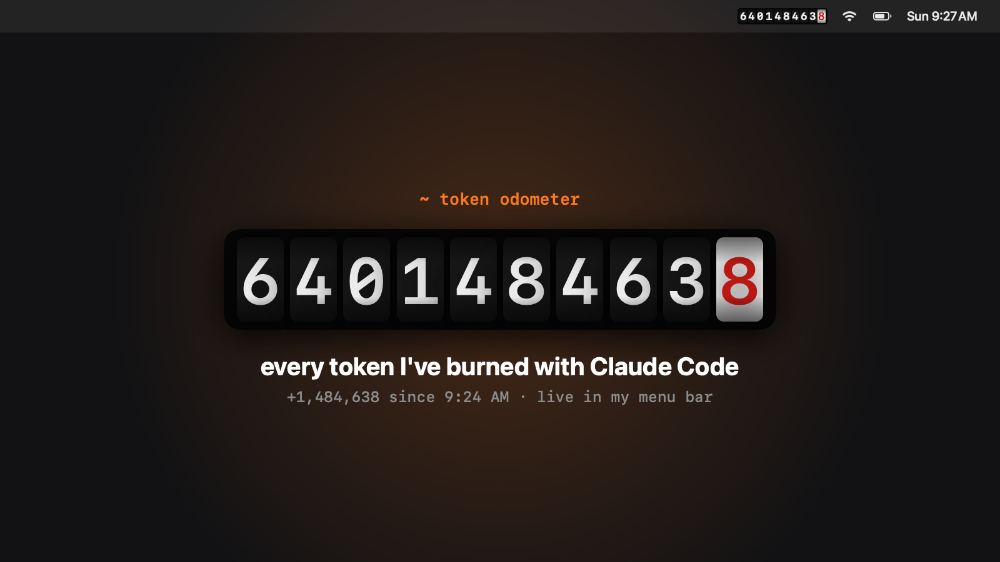

# Token Odometer

A tiny macOS menu bar app that shows every token you've burned with **Claude Code** on a mechanical odometer that rolls up in real time.



▶️ [Watch the wheels roll (7 s clip)](docs/demo.mp4)

## What it does

- **Lifetime odometer in the menu bar:** 10 rolling wheels that only ever turn forward. It counts every token, cache reads included, and never resets.
- **Dashboard on click:**
  - **Today** meter, which rolls on to zero at midnight.
  - **Speedometer** showing tokens per minute over the last 60 s.
  - Input, output and cache breakdown, plus per-model bars.
  - **Trip A** meter you can reset.
  - **Open at login** toggle.
- **100% local:** it reads Claude Code's own transcripts in `~/.claude/projects/**/*.jsonl`. No API keys, no network, nothing leaves your Mac.

Messages are de-duplicated by ID, so resumed sessions and repeated log lines count once. Re-reading a day's transcripts (hundreds of MB) takes about 1.5 s, and after that it just tails new lines every 2 s.

## Build & run

Requires macOS 14+ and Swift 6 (Xcode or the command line tools).

```bash
./scripts/build-app.sh
open build/TokenOdometer.app
```

### Options

```bash
# start the lifetime reading from your own number (quit the app first)
build/TokenOdometer.app/Contents/MacOS/TokenOdometer --lifetime 6400000000

# launch at login on/off (also a checkbox in the dashboard)
build/TokenOdometer.app/Contents/MacOS/TokenOdometer --login on

# render a share clip (MP4 + poster PNG) from your real numbers
build/TokenOdometer.app/Contents/MacOS/TokenOdometer --promo ./clip
```

### Tests

```bash
swift test
```

## Layout

- `Sources/OdometerCore`: the transcript tailer, parser, dedupe/tally (today, trip, lifetime, speed) and odometer math.
- `Sources/TokenOdometer`: the AppKit status item, SwiftUI wheels and dashboard, and the promo renderer.

Vibe coded with Claude Code. Not affiliated with Anthropic.
